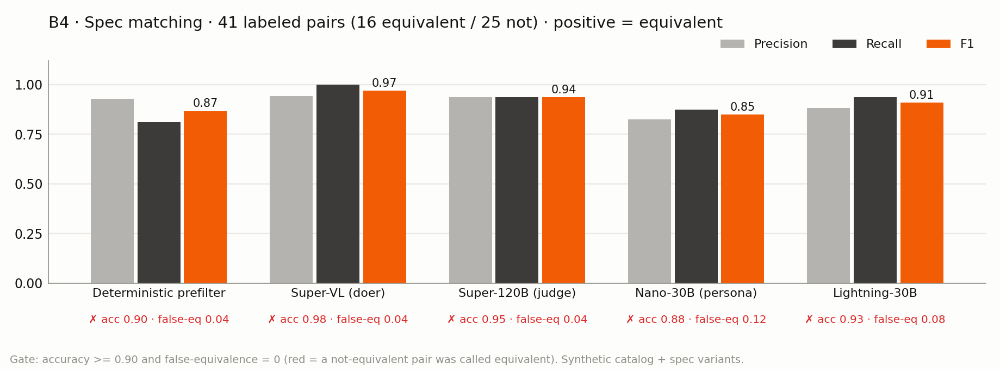
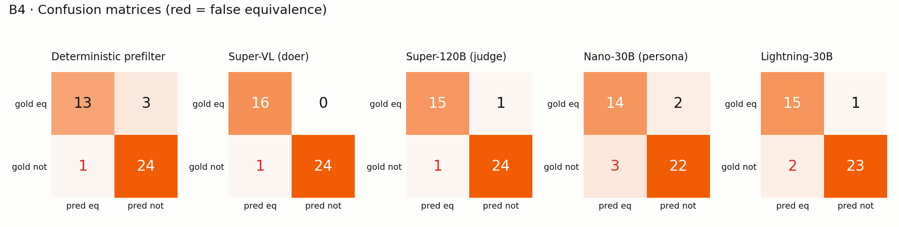
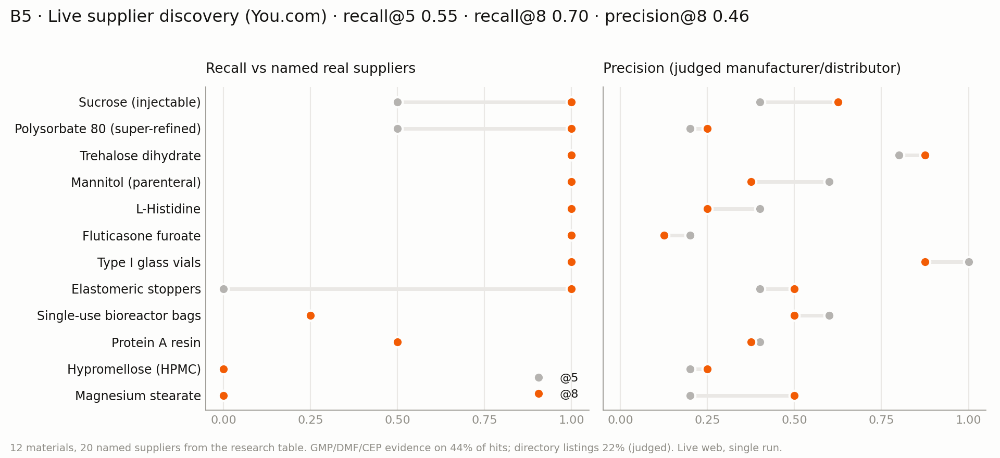
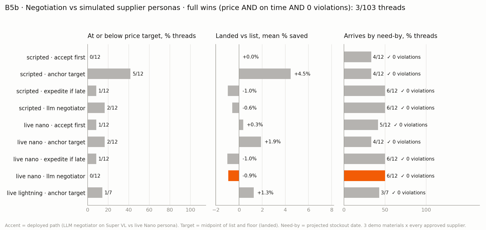
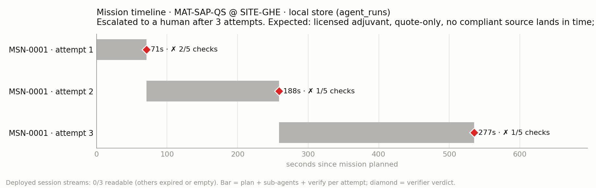

# Evaluation results: Supplier Chief of Staff

Run on 2026-10-17 against Crusoe serverless inference and live You.com search. The customer (Corvane Biologics), its sites, materials, suppliers, stock and prices are synthetic. Supplier replies are simulated personas. The real-world supplier names in B5 come from the public research table in `.context/research/supplier-landscape.md` and are used only as discovery ground truth.

Harness: `evals/` (`@supply-agent/evals`). Raw results are in `docs/evals/results/*.json`, plots in `docs/evals/png/`, and the combined table in `docs/evals/results/summary.json`. The same plots and table appear on sheets 10 and 11 of `docs/architecture.pdf`.

```bash
pnpm --filter @supply-agent/evals run all          # every benchmark, then summary + plots
pnpm --filter @supply-agent/evals run b1           # or b3, b4, b5, b5b, b6, summary, plot
EVAL_MODELS=Super-VL,Nano pnpm --filter @supply-agent/evals run b1   # subset of models
EVAL_RESUME=1 pnpm --filter @supply-agent/evals run b3               # re-run only rows that errored (429 etc.)
SCOS_URL=https://supplier-chief-of-staff.vercel.app pnpm --filter @supply-agent/evals run b6
INKLING_MODEL=<self-serve alias> pnpm --filter @supply-agent/evals run all   # adds Inkling-Small as a candidate
```

## Headline

<!-- HEADLINE -->

## Which model takes which role

<!-- ROLES -->

## Models and settings

| Model id (Crusoe) | Short name | Role today | $ / 1M in / out |
|---|---|---|---|
| `nvidia/NVIDIA-Nemotron-3.5-Super-VL` | Super-VL | planner and sub-agents (doer) | 0.10 / 0.40 |
| `nvidia/NVIDIA-Nemotron-3-Super-120B-A12B` | Super-120B | verifier (judge) | 0.30 / 2.40 |
| `nvidia/NVIDIA-Nemotron-3-Nano-30B-A3B` | Nano-30B | supplier personas | 0.05 / 0.20 |
| `nvidia/Nemotron-3.5-Lightning-30B-A3B` | Lightning-30B | persona fallback | 0.05 / 0.20 |

Inkling-Small was not benchmarked: `INKLING_MODEL` was not set (no self-serve deployment was running). Setting it adds the alias to B1, B3 and B4 with no code change.

Common settings: temperature 0, `max_tokens` 4096 (8192 in B3), thinking left at each model's default as deployed (the persona path sets `enable_thinking: false`, as in production). The client paces requests to at most 26 per minute per model, keeps 4 in flight, and backs off on 429/503 (core `chat()` with `maxRetries` 6). After 4 consecutive failures a model is skipped for the rest of a run, and that is recorded as errors, not misses. Interval estimates are 95% Wilson intervals.

<!-- B1 -->

<!-- B3 -->

## B4 · Spec matching




**Method.** 41 labelled pairs (16 equivalent, 25 not equivalent). They are built from the seed catalog: real neighbours such as injectable vs oral sucrose, histidine base vs HCl, 2R vs 6R vials and the QS-class analogue vs the licensed adjuvant, plus spec variants of catalog records (anhydrous vs dihydrate, endotoxin class, missing JP, 15 vs 5 mPa.s HPMC, neat vs blended clavulanate, alternate process-locked bags and resins, animal-origin squalene). Four pairs are deliberately hard: three synonyms (Tris/tromethamine, glycerin/glycerol, HPMC/hypromellose) and one origin change that is only in the name (beet vs cane sucrose). We score (a) the deterministic `specPrefilter` used by `match_spec`, where `exact` counts as equivalent, and (b) each model alone, given both records' spec fields. Positive class = equivalent; false-equivalence rate = not-equivalent pairs called equivalent.

| Method | Accuracy | Precision | Recall | F1 | False-equivalence | Gate (acc ≥ 0.90, false-eq 0) |
|---|---|---|---|---|---|---|
| Deterministic prefilter (code) | 0.90 | 0.93 | 0.81 | 0.87 | 0.04 (1/25) | fail (false-eq) |
| Super-VL | **0.98** | 0.94 | 1.00 | **0.97** | 0.04 (1/25) | fail (false-eq) |
| Super-120B | 0.95 | 0.94 | 0.94 | 0.94 | 0.04 (1/25) | fail (false-eq) |
| Lightning-30B | 0.93 | 0.88 | 0.94 | 0.91 | 0.08 (2/25) | fail |
| Nano-30B | 0.88 | 0.82 | 0.88 | 0.85 | 0.12 (3/25) | fail |

**Findings.**
- The single false equivalence shared by every method is P41: a sucrose offer that differs from the current source only in botanical origin (beet vs cane), and the difference is visible only in the name. The prefilter cannot see it because origin is not a structured field, and no model flagged it either. **Fix: add `origin` (botanical/animal/synthetic) to `Material` and compare it in `specPrefilter`.** With that field, the prefilter would reach 0 false equivalences on this set.
- The prefilter's other misses are the three synonym pairs, which it rejects. That is the safe direction (a missed substitute, never a wrong one). A synonym table (or a PubChem CID match) would fix them.
- Models add recall (Super-VL found all 16 equivalents), but the smaller models also add false equivalences: Nano accepted a candidate missing JP and an alternate validated bag assembly. Using a model only as a veto on top of the prefilter ("hybrid" in the JSON) never lowers false-equivalence below the prefilter's 1/25 here, and it costs recall. **Decision: spec equivalence stays in code. Models may explain the result but never upgrade a mismatch.**
- Latency in B4 (Super-VL p50 7.6 s, p95 19 s) was measured during a provider congestion window: a bare "say hi" to Super-VL took 19 s at that time and 0.7 s ten minutes later. Use the B1 latency numbers instead.

## B5 · Live supplier discovery (You.com)



**Method.** `discover_suppliers` (the agent's real tool, `max_results` 8, `read_pages` 2) runs live for 12 catalog materials. Ground truth is the real suppliers named for each material in the research table (20 suppliers in total). A hit matches when its host or name contains a supplier alias (Merck = merckgroup / sigmaaldrich / milliporesigma / emdmillipore). Precision is judged by Super-120B, which labels each hit as manufacturer, distributor, directory or noise; precision@k = (manufacturers + distributors of this material) / k. We also replay the exact queries straight to You.com, with no filters, to see what the tool's filters drop.

| Metric | Value |
|---|---|
| Recall@5 (micro, 20 named suppliers) | **0.55** |
| Recall@8 (micro) | **0.70** (macro 0.73) |
| Recall in the raw, unfiltered results (any rank) | 0.70 |
| Precision@5 / @8 (judged) | 0.45 / 0.46 |
| Hits with GMP / DMF / CEP evidence | 44% |
| Directory listings (tool label / judged) | 20% / 22% |
| Hits surviving the scout's keep-rule | 3.3 of 8 per material |
| Mean tool latency (2 searches + 1 contents call) | 7.7 s |

| Material | Named suppliers (truth) | Found @5 | Found @8 | Recall@8 | Precision@8 | GMP/DMF/CEP hits | Directory hits | Survive scout rule (truth kept) |
|---|---|---|---|---|---|---|---|---|
| Sucrose, injectable (`MAT-SUC-INJ`) | Pfanstiehl, Merck/SAFC | Pfanstiehl | Pfanstiehl, Merck | 1.00 | 0.62 | 4/8 | 3/8 | 4/8 (Pfanstiehl) |
| Polysorbate 80 SR (`MAT-PS80-SR`) | Croda, Merck/SAFC | Croda | Croda, Merck | 1.00 | 0.25 | 4/8 | 3/8 | 4/8 (Croda) |
| Trehalose dihydrate (`MAT-TRE-HP`) | Pfanstiehl | Pfanstiehl | Pfanstiehl | 1.00 | 0.88 | 5/8 | 1/8 | 5/8 (Pfanstiehl) |
| Mannitol, parenteral (`MAT-MAN-PAR`) | Roquette, Pfanstiehl | both | both | 1.00 | 0.38 | 6/8 | 2/8 | 6/8 (both) |
| L-Histidine (`MAT-HIS`) | Merck/SAFC, Pfanstiehl | both | both | 1.00 | 0.25 | 5/8 | 2/8 | 5/8 (both) |
| Fluticasone furoate (`MAT-FF`) | Hovione | Hovione | Hovione | 1.00 | 0.12 | 3/8 | 4/8 | 3/8 (none) |
| Type I vials (`MAT-VIAL-2R`) | SCHOTT Pharma | SCHOTT | SCHOTT | 1.00 | 0.88 | 2/8 | 0/8 | 0/8 (none) |
| Stoppers (`MAT-STOP-13`) | West | - | West | 1.00 | 0.50 | 3/8 | 0/8 | 3/8 (none) |
| Single-use bags (`MAT-SUB-2000`) | Sartorius, Cytiva, Thermo Fisher, ABEC | Sartorius | Sartorius | 0.25 | 0.50 | 2/8 | 2/8 | 2/8 (none) |
| Protein A resin (`MAT-PROA`) | Cytiva, Purolite | Cytiva | Cytiva | 0.50 | 0.38 | 3/8 | 0/8 | 3/8 (none) |
| HPMC (`MAT-HPMC`) | Shin-Etsu | - | - | 0.00 | 0.25 | 1/8 | 1/8 | 1/8 (none) |
| Magnesium stearate (`MAT-MGST`) | Peter Greven | - | - | 0.00 | 0.50 | 4/8 | 3/8 | 4/8 (none) |

### What the scout searches for

`discoveryQueries()` in `packages/core/src/tools/stubs.ts` sends at most two queries per material, built only from the material master:

1. `{substance} {grade, "/" → " "} GMP manufacturer DMF CEP`, for example `sucrose parenteral low-endotoxin GMP manufacturer DMF CEP`
2. `{substance} {first two compendia} pharmaceutical grade supplier`, for example `sucrose USP-NF Ph. Eur. pharmaceutical grade supplier`. If the caller passes a free-text `query`, that query replaces this one.

Each query goes to `GET https://ydc-index.io/v1/search?query=…&count=min(20, max_results + 4)` (count 12 here). Then the tool applies these filters:

- **Dropped hosts (reference sites):** wikipedia.org, ncbi.nlm.nih.gov, sciencedirect.com, researchgate.net, youtube.com, fda.gov, ema.europa.eu, edqm.eu, reddit.com, linkedin.com, facebook.com, springer.com, mdpi.com, nature.com, pubchem.ncbi.nlm.nih.gov, drugbank.com, accessdata.fda.gov; plus any `*.translate.goog` proxy.
- **Labelled as `directory` but kept:** pharmacompass, pharmaoffer, chemicalbook, made-in-china, alibaba, indiamart, echemi, lookchem, tradeindia, pipelinepharma, dcatvci, cphi-online, pharmasources, molbase, guidechem, pharmaceutical-technology, pharmaexcipients, pharmtech, europeanpharmaceuticalreview, chemeurope, thomasnet, kompass, pharmasalmanac.
- **One candidate per host**, in result order, truncated to `max_results`.
- **Page reads:** the top `read_pages` (2) non-directory hits are fetched with You.com contents, and compliance claims are extracted by regex (GMP, US DMF, CEP, USP-NF, Ph. Eur., JP, ChP, low endotoxin, parenteral, ISO 9001). These are the supplier's own claims, not verified status.
- **Scout keep-rule** (in `subagents/scout/instructions.md`, applied by the model): keep only candidates whose evidence names the substance *and* shows a GMP, DMF or CEP signal.

**Findings.**
- The filters cost no recall: the raw replay finds the same 14 of 20 named suppliers. Every miss is a query miss. Shin-Etsu (HPMC), Peter Greven (magnesium stearate), Cytiva/Thermo/ABEC (bags) and Purolite (Protein A) never appear in the raw results either.
- **The scout keep-rule drops the real manufacturer for 5 of 12 materials** (Hovione, SCHOTT, West, Sartorius, Cytiva). Their pages do not use the words GMP, DMF or CEP in the snippet or in the first page excerpt. Packaging and process consumables do not carry DMF/CEP in the same way; the research table itself says not to require a CEP for bags and resins.
- About a fifth of hits are directories (pharmacompass, pharmaoffer, pharmaexcipients). They are labelled correctly but still take result slots.
- Recommended changes, not made here because core is another agent's area: class-aware query templates (packaging/consumables: drop "DMF CEP", use the USP chapter and "manufacturer"); synonym or brand queries (HPMC, hypromellose 2910, METOLOSE-type brand terms); a class-aware keep-rule; dropping directory hosts from the top-k instead of only labelling them; and collapsing the double space in the HPMC query (`2910   5 mPa.s`).

## B5b · Negotiation against simulated supplier personas



**Method.** Three demo positions: injectable sucrose at Ghent (hero; 370 kg, need-by 2026-11-10), polysorbate 80 SR at King of Prussia (5 kg, need-by 2027-02-28) and parenteral mannitol at Raleigh (582 kg, need-by 2026-10-28). For each, `draft_rfq` creates the RFQ, and every approved supplier (4 per material) is negotiated through the real `message_supplier` and `accept_offer` tools. Buyer policies:

- `accept_first`: open, then accept.
- `anchor_target`: open, counter twice at the low end of the supplier's price band, then accept.
- `expedite_if_late`: open; ask to expedite if the lead time misses need-by; one price counter; accept.
- `llm_negotiator`: Super-VL drives the two tools with the negotiator's `instructions.md`, at most 8 steps.

Personas: the deterministic scripted persona, live Nano (production), and live Lightning (anchor policy only). Scoring is core `negotiationOutcome()`: landed USD/unit vs list, arrival vs need-by, and policy violations. Win = landed price at or below the list/floor midpoint AND on time AND 0 violations. Need-by is the projected stockout date, which several standard lead times cannot meet, so a full win is rare by design. The parts are reported separately.

| Persona · policy | Threads | At/below price target | Mean saved vs list | On time | Full win | Policy violations | Persona offers clamped |
|---|---|---|---|---|---|---|---|
| scripted · accept_first | 12 | 0/12 | 0.0% | 4/12 | 0/12 | 0 | 4/12 |
| scripted · anchor_target | 12 | 5/12 | +4.5% | 4/12 | 1/12 | 0 | 26/36 |
| scripted · expedite_if_late | 12 | 1/12 | -1.0% | 6/12 | 0/12 | 0 | 23/32 |
| scripted · llm_negotiator | 12 | 2/12 | -0.6% | 6/12 | 1/12 | 0 | 19/34 |
| live Nano · accept_first | 12 | 1/12 | +0.3% | 5/12 | 0/12 | 0 | 1/12 |
| live Nano · anchor_target | 12 | 2/12 | +1.9% | 4/12 | 1/12 | 0 | 4/36 |
| live Nano · expedite_if_late | 12 | 1/12 | -1.0% | 6/12 | 0/12 | 0 | 6/32 |
| **live Nano · llm_negotiator (deployed path)** | 12 | 0/12 | -0.9% | 6/12 | 0/12 | **0** | 11/35 |
| live Lightning · anchor_target | 7 (6 lost to 429) | 1/7 | +1.3% | 3/7 | 0/7 | 0 | 0/19 |

**Findings.**
- **Policy violations: 0 of 103 threads**, as designed. Code clamps every persona offer to the hidden profile, and quotes are created only from the stored offer. The clamp is busy: the live Nano persona tried to go outside its limits in 22 of 115 supplier turns (19%) across the four policies, and the clamp corrected every one. Lightning stayed inside its limits in 19/19 turns, but 6 of its 13 threads died on provider 429s.
- **The LLM negotiator trades price for lead time.** It asks for an expedite whenever the date is tight, which raises on-time from 4/12 to 6/12 (same as the scripted expedite policy), but it pays the expedite premium and lands 0.9% *above* list on average. The fixed `anchor_target` policy saves more (+1.9% vs live Nano, +4.5% vs scripted) but is on time less often. Neither gets a cheap and on-time result often, because most standard lead times exceed the days to stockout. That gap is what the transfer branch and the escalation path are for.
- **Don't trust the negotiator's own "meets need-by" line.** In one of 12 deployed-path threads (mannitol, SUP-004) it reported "meets need-by" for a 19-day lead time that lands 2026-11-05, after the 2026-10-28 need-by. The mission already recomputes `lands_in_time` in code (`evaluateChecks`), so this does not reach a decision. It is another reason that date arithmetic stays in code.

## B6/B8 · Mission telemetry



**Method.** `b6-missions.ts` reads each id in `docs/evals/missions.txt` from `GET $SCOS_URL/eve/v1/session/<id>/stream` (NDJSON). It pulls `agent.started` (sub-agent count), `action.partial` with stage `planned`/`branches_done`/`verified` (timeline, attempts, checks) and `step.completed` usage (tokens). A stream that stays open is read for 25 s. As a second, clearly labelled source, it reads the local mission records (`missions` + `agent_runs` in `.data/state.json`).

| Source | Mission | Result |
|---|---|---|
| deployed stream `wrun_41M55RN7HZ0GH7JJ5RE0CF1Z95` | - | HTTP 410 `session_expired` |
| deployed stream `wrun_41M55SXBP50GGT37XRSWXBSMY4` | - | HTTP 410 `session_expired` |
| deployed stream `wrun_41M55T96SZ0GYH8G6AR6BJA831` | - | HTTP 200, stream open, no events within 25 s |
| local store | `MSN-0001` saponin adjuvant (MAT-SAP-QS) @ Ghent | 3 attempts, 535 s wall, final checks 1/5, escalated to the planner |

**Findings.**
- None of the three deployed sessions could be read. Two had expired, and the third was an open stream that sent no events. **B6 (9 of 10 hero runs complete) and B8 (p95 under 90 s) remain unmeasured for the deployed build.** Run hero missions and read their streams within the session-retention window. `b6-missions.ts` computes both gates as soon as streams are readable.
- The one local mission is the guardrail scenario. The licensed adjuvant is quote-only, and no qualified source lands inside the 60-day safety window. The agent re-planned twice, then escalated without substituting the analogue, which is the intended outcome. Its 535 s wall time (71 s, 188 s, 277 s per attempt) shows that re-plans get slower, and that missions which end in escalation will not meet a 90 s alert budget unless the escalation alert is sent after the first failed attempt that `plan.unfixable` flags.
- This build records `tokens_in`/`tokens_out` as 0 on verifier runs, so local token telemetry is missing. Recording usage on every `agent_run` would make B8 cost-per-mission measurable.

## Cost and time

<!-- COST -->

## Caveats

- **Synthetic data, small n.** 12 to 41 items per benchmark, single runs. A 0/12 violation result is consistent with a true rate up to 24%. Treat the gates as screens, not certification.
- **Moving target.** Another agent changed the planner prompt, the negotiator prompt and the core tool set (now including `material_dossier`, `line_feasibility`, `record_delivery`, `supplier_reliability`) during this session. B1 and B3 were re-run on commit 977f24e; B4, B5 and B5b do not depend on those changes. B5b used the earlier negotiator prompt, which lacked the `negotiation_history` hint. That hint has no effect on a fresh store, because there is no history yet.
- **Provider effects.** Lightning hit `max_requests_limit (orchestrator)` 429s throughout the day. Those rows are errors, not misses. Super-VL latency spiked during the B4 run. Latencies are wall-clock times including retries.
- **Judging.** B3 and B5 precision use a model judge (Super-120B; Super-VL judges Super-120B's own answers). In B3 the deterministic checks and the judge agreed on every scored answer in the final run. A pilot run exposed two harness bugs, both fixed before the reported run: the judge did not see follow-up tool outputs, and follow-up tools ran on a store without the RFQ. In that pilot, one model reported "Approved … PO drafted" after `apply_approval` had returned `not found`. That failure mode (claiming a tool action succeeded when it errored) is worth a dedicated B3 case.
- **B5 ground truth is partial.** The research table names a short list per material. Other legitimate manufacturers count against recall only if they push a named one out of the top k, and they count as precise when the judge says so.
- **Not covered:** B2 (grounded answers), B5 in the original model-selection sense (quote extraction) and B7 (fault recovery) are not implemented yet.
